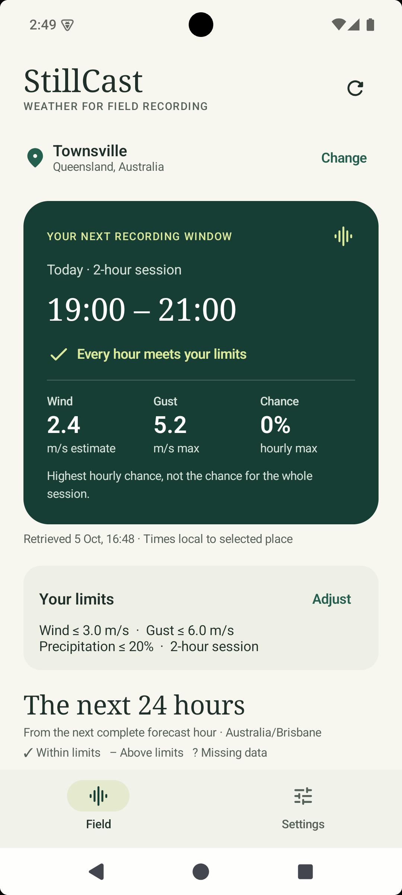
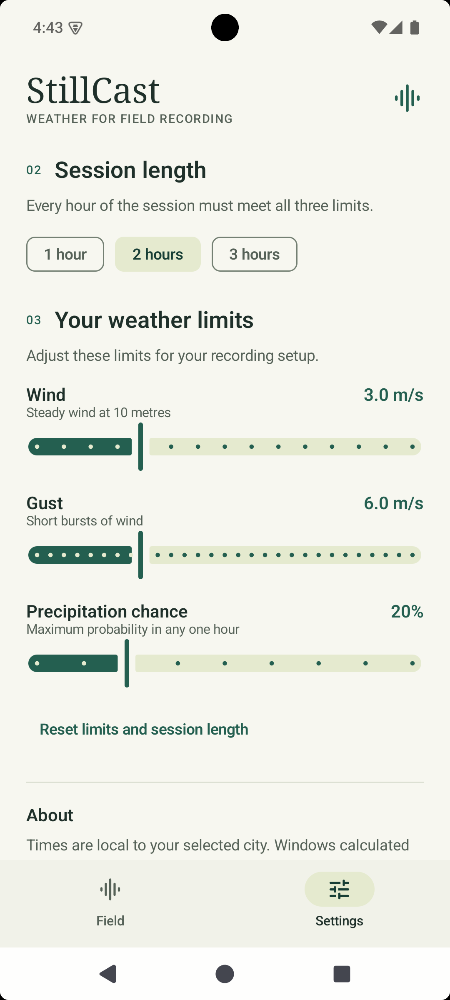

# StillCast

StillCast helps plan outdoor sound recordings, such as birdsong or running water. Choose a city, a session length of 1–3 hours, and limits for wind, gusts and rain. The app finds the first complete session in the next 24 hours that meets those limits.

## Screenshots

| Field — next recording window | Settings — session length and weather limits |
|---|---|
|  |  |

## Run in Android Studio

1. Open the `StillCast` folder containing `settings.gradle.kts`.
2. Select **JDK 21** under Settings → Build, Execution, Deployment → Build Tools → Gradle → Gradle JDK.
3. Install **Android SDK Platform 36** if prompted and let Gradle Sync finish.
4. Choose the `app` configuration and an **Android 8.0 / API 26** or newer emulator or device, then click **Run**.

If Studio reports that Gradle 8.13 is incompatible with its default JDK 25, choose **Use JVM 21**. If JDK 21 is not listed, use **Download JDK** in the Gradle JDK selector, then sync again.

Weather forecasts and city search need an internet connection. No account, API key or runtime permission is needed. The project includes the Gradle wrapper and uses Google's Maven Central mirror because the standard endpoint was unavailable on the development network.

For an offline preview, open `UtilityAppPreview` or `SettingsScreenPreview` in Android Studio. These use fixed example data.

## Using the app

- **Field** shows the next matching session, its local start and end times, wind estimate, peak gust and highest hourly rain chance. Expand the hourly list to see the readings, or refresh to fetch new data.
- **Settings** lets you search for a city, choose a duration and change the three weather limits. Search needs at least two characters; two-character searches only match exact place names. Changing the duration or limits updates the result using the forecast already loaded. Choosing another city fetches its forecast.

The app shows separate messages for loading, no match, missing data and failed requests. If a refresh fails, it keeps the last forecast and shows when it was fetched. At one hour old, the forecast is marked stale. At three hours, the recommendation and hourly list are hidden until new data arrives. Setting the device clock back cannot make expired data fresh again.

Settings survive switching screens, rotation and returning from the background. They reset when the app process restarts.

The app starts in Townsville with a 2-hour session, wind ≤ 3 m/s, gust ≤ 6 m/s and hourly rain chance ≤ 20%. These defaults are recording preferences; they do not describe a microphone's weather resistance.

## Choosing a session

`WindowPlanner` checks consecutive hours within the next 24 hours. Every hour in a session needs all three weather readings, and each reading must be at or below its limit. It returns the earliest match. Missing readings never count as zero.

Open-Meteo's gust and precipitation readings describe the hour ending at their timestamp. For example, the 10:00 readings apply to 09:00–10:00. For wind, the planner takes the larger reading at the start and end of the hour. This estimates conditions between those readings; it cannot give the maximum wind throughout the hour. Times use the selected city's time zone, including daylight-saving changes.

The displayed rain chance is the highest hourly probability in the session, not the probability for the whole session. The forecast also cannot account for local shelter, traffic noise or microphone protection, so a matching session does not guarantee a good recording.

## Code structure

StillCast extends the supplied Utility App starter, keeping its single activity and two-screen bottom navigation.

| Component | What it does |
|---|---|
| `UtilityApp`, `UtilityScreen`, `SettingsScreen` | Two Material 3 screens with a bottom bar in one activity |
| `AppViewModel` | Holds screen state, handles settings changes and manages requests |
| `WeatherRepository` / `OpenMeteoRepository` | Fetches data with Retrofit and checks it before passing it to the planner |
| `WindowPlanner` | Calculates suitable sessions using plain Kotlin |
| `Components` | Shares controls and display formatting between screens |

`StillCastApplication` creates the repository and passes it to `AppViewModel`. The ViewModel holds the state for both screens; the screens send actions back through callbacks. Tests replace the repository with fixed responses, so they can check failures and timing without relying on the weather service. The app has one module and switches between two screens without a navigation graph.

## Tests

JVM tests are in `app/src/test`; activity and Compose tests are in `app/src/androidTest`. In Android Studio, right-click a test class and choose **Run**. From a terminal with JDK 21 selected:

```sh
sh ./gradlew testDebugUnitTest lintDebug assembleDebug
sh ./gradlew connectedDebugAndroidTest
```

The second command needs a running emulator or device. On Windows, use `gradlew.bat` instead of `sh ./gradlew`. Using `sh` avoids a permission error if ZIP extraction loses the wrapper's executable bit.

Tests cover time boundaries, limits, missing data, response validation, overlapping requests, settings and screen interactions.

[Android checks](https://github.com/XIAOERDONG933/StillCast/actions/workflows/android.yml) runs the JVM tests, Android Lint and debug builds on Ubuntu and Windows for pushes and pull requests to `main`. Reports and debug APKs are kept for 14 days. CI builds the device-test APK but does not run device tests.

On 15 October 2026, 67 JVM tests and 17 device tests passed. Lint found no errors, and both debug APKs built successfully. The device tests ran on an API 35 emulator and covered activity recreation, returning from the background, and narrow and landscape layouts at 200% text size. A separate TalkBack check covered navigation, city search and the settings controls. The [verification notes](docs/verification.md) describe these checks and what they do not cover.

## Data sources and privacy

- Weather: [Open-Meteo](https://open-meteo.com/). Places: [GeoNames](https://www.geonames.org/), via Open-Meteo. Data: [CC BY 4.0](https://creativecommons.org/licenses/by/4.0/). StillCast calculates the recording windows.
- API references: [forecast](https://open-meteo.com/en/docs) and [city search](https://open-meteo.com/en/docs/geocoding-api).
- City searches and coordinates are sent to Open-Meteo. No GPS, microphone or analytics are used; settings and forecasts stay in memory. See [service terms and privacy](https://open-meteo.com/en/terms).
